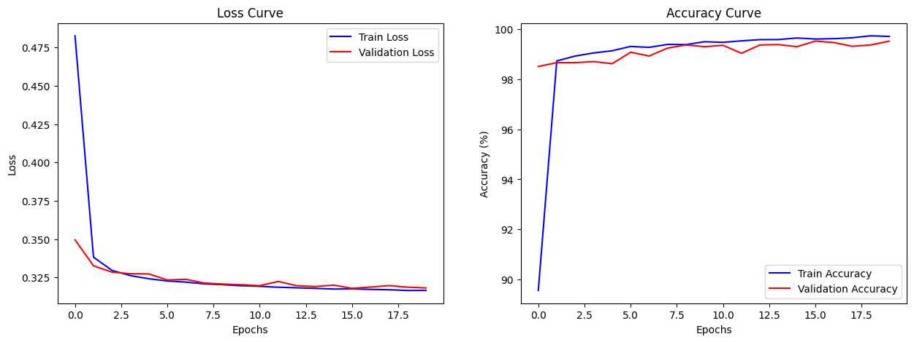
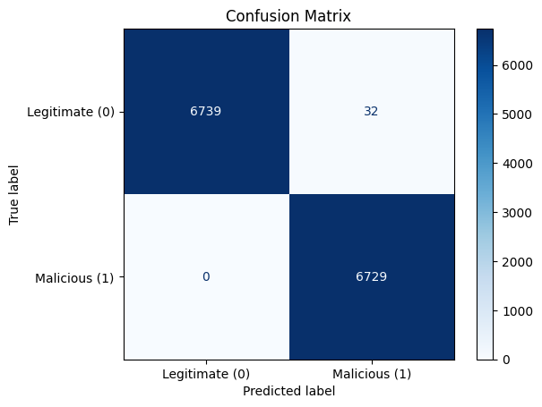
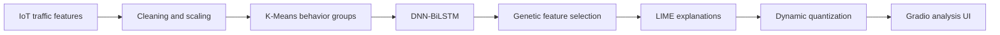
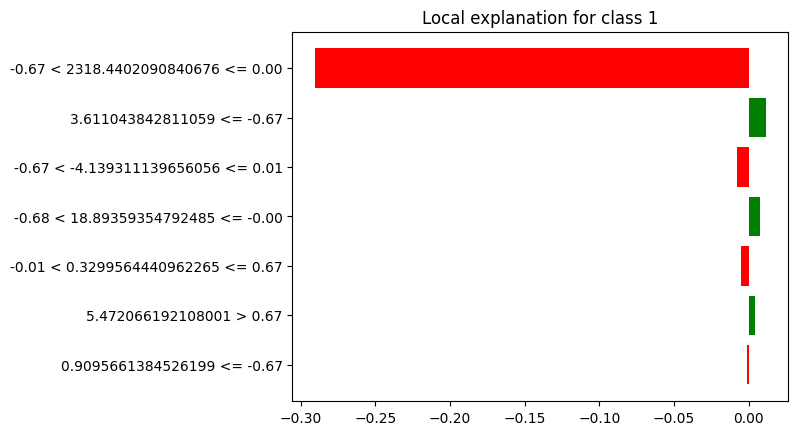

# Explainable IoT Intrusion Detection

[](https://github.com/NorShadeed/iot-ids-xai/actions/workflows/notebooks.yml)


An experimental IoT network-behavior pipeline that combines DNN and bidirectional LSTM layers, genetic-algorithm feature selection, LIME explanations, dynamic quantization, and a Gradio analysis interface.

## Saved evaluation result

The feature-selected DNN-BiLSTM notebook includes a saved held-out evaluation over 13,500 samples:

| Metric | Saved result |
| --- | ---: |
| Test accuracy | 99.76% |
| Precision | 99.53% |
| Recall | 100.00% |
| F1 score | 99.76% |
| Baseline model size | 300.06 KB |
| Quantized model size | 108.83 KB |
| Size reduction | 63.73% |

These figures reproduce the outputs stored in the research notebook; they are not presented as independent benchmark results. The notebook derives binary behavior groups with K-Means before supervised model training, so results should be interpreted within that experimental design.

| Training behavior | Quantized-model confusion matrix |
| --- | --- |
|  |  |

## Pipeline



### Explainability

LIME is used to show how individual features influence a selected prediction.



## Repository contents

- `DL_IID_with_XAI.ipynb` - preprocessing, clustering, model training, genetic feature selection, evaluation, LIME, and quantization.
- `GUI.ipynb` - Gradio-based model analysis interface with visualizations and PDF reporting.
- `data/README.md` - expected dataset placement and portability notes.

## Run the notebooks

```bash
python -m venv .venv

# Windows
.venv\Scripts\activate

# macOS/Linux
source .venv/bin/activate

pip install -r requirements.txt
jupyter lab
```

Set `IOT_IDS_DATASET` to the source CSV path and optionally set `IOT_IDS_OUTPUT_DIR` for generated models and explanations. Google Colab remains supported, but the notebooks no longer depend on one hard-coded Drive directory.

## Limitations

- The original dataset is not redistributed in this repository.
- The saved metrics reflect one experimental split and clustering configuration.
- Deployment on real networks requires validation against labeled, time-separated traffic and monitoring for data drift.
- Intrusion-detection decisions should be reviewed by a security analyst.
